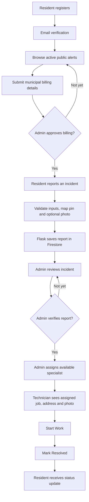

# MetroNotify — Municipal Service Reporting & Management

**RIT-CodeCatalysts | Final Integrated Project**

> Report it. Track it. Get it fixed.

We developed MetroNotify as a municipal service reporting and management web application. Our goal is to make it easier for residents to report problems, for municipal administrators to verify and dispatch incidents, and for technicians to complete their assigned work. We also bring public service alerts, maps, notifications and gamification into one platform.

**Repository:** [RIT-CodeCatalysts / MetroNotify-Final-Code](https://github.com/RIT-CodeCatalysts/MetroNotify-Final-Code/tree/metro-final-updates)
**Branch:** `metro-final-updates`

## Technology stack

| Layer | Technology | What it does |
| --- | --- | --- |
| Website (frontend) | **React (JavaScript)** | Pages, forms, role-based dashboards, maps and alerts |
| Backend API | **Python + Flask** | Checks requests, permissions, reports, jobs and private photo access |
| Authentication | **Firebase Authentication** | Sign-up, sign-in, email verification and password reset |
| Database | **Cloud Firestore** | User profiles, reports, tickets, staff records, alerts and notifications |
| Maps | **React Leaflet/Leaflet + Google Maps links** | Select incident locations and help technicians navigate |
| Incident photos | **Private local storage via Flask** | Stores validated photos on the computer running the backend |

## Our application workflow



### 1. Resident / Ratepayer Experience

- Create an account and follow the email-verification link sent through Firebase Authentication.
- **While municipal billing approval is pending**, residents can still view published Active Alerts and other public information. Reporting remains locked until approval.
- Enter municipal account number, property address and municipality for **Admin review**. The project does **not** automatically query a real municipal billing system.
- After approval, submit an incident with service type, description, date, address and an **incident map pin**; attach a JPG/PNG image if needed.
- The form checks required details, dates, location and prohibited language. For example, it may display: *“Your report contains language that is not allowed on MetroNotify. Please rephrase it.”*
- View incident status and notifications. Gamification features include points, levels, badges, streaks and leaderboard-related functions; exact rewards depend on the backend rules.
- Forgot your password? Use **Forgot Password** on the sign-in screen and follow the reset email.

### 2. Municipal Admin Experience

- Review municipal billing information and approve, reject or revoke ratepayer reporting access after checking authorised records.
- Open **Reports & Dispatch**, review incident details, private photo and location, then **Verify Report** when appropriate.
- Choose an available technician with the matching speciality; dispatch is **manual**, not automatic.
- Publish public alerts for verified issues and manage or end them when work is resolved.
- Review technician coverage, notifications, enquiries and verified public alert locations.
- Private street addresses and incident photos are not made public through the alert feed.

### 3. Technician Experience

- Staff accounts are **invited by Admin**. They use **Forgot Password** to set a password rather than public staff registration.
- View only tickets assigned to their authenticated account, including incident description, street/landmark, suburb, municipality, GPS coordinates and optional private photo.
- Use **Open in Google Maps** to navigate to the incident.
- Select **Start Work** and later **Mark Resolved**; updates are stored in Firestore.
- The team overview shows basic team job progress, **not** other residents' private addresses or descriptions.

## Demonstration login emails

| Role | Email |
| --- | --- |
| Municipal Admin | `nyabanhi@gmail.com` |
| Electrical Technician | `metronotify14+electrical@gmail.com` |
| Plumbing Technician | `metronotify14+plumbing@gmail.com` |
| Roads / Civil Technician | `metronotify14+roads@gmail.com` |
| Traffic Technician | `metronotify14+traffic@gmail.com` |
| Waste Technician | `metronotify14+waste@gmail.com` |
| Security Technician | `metronotify14+security@gmail.com` |

**We do not publish passwords in our repository.** Each authorised user can recover access through our Forgot Password flow. Signing in alone does not grant staff permissions: roles are checked against our Firebase and Firestore records.

## Running our project locally (Windows / VS Code)

### What our development environment needs

- Git, Python and Node.js/npm installed.
- Access to the **existing Firebase project** and its configuration, granted by the project team.
- Firebase credentials/configuration supplied **privately**, never committed to GitHub.

### 1. Our GitHub branch

```powershell
 git clone -b metro-final-updates https://github.com/RIT-CodeCatalysts/MetroNotify-Final-Code.git
 cd MetroNotify-Final-Code
```

A private organization repository requires GitHub access.

### 2. Flask backend (Terminal 1)

```powershell
cd backend
py -m venv .venv
& ".\.venv\Scripts\python.exe" -m pip install -r requirements.txt
& ".\.venv\Scripts\python.exe" -m pip install Pillow
```

Configure Firebase Admin credentials using the team's private setup instructions and `backend/backend.env.template` where applicable. Set `FRONTEND_ORIGIN=http://localhost:3000` if needed. **Do not commit service-account JSON files or secrets.**

```powershell
& ".\.venv\Scripts\python.exe" app.py
```

**Backend:** http://127.0.0.1:5000
**Health check:** http://127.0.0.1:5000/

> **Dependency note:** The repository's dependency list may contain an older `pygeohash` package. On Windows, some environments block its compiled DLL. If installation or startup fails, compare with the tested team's environment and fix the dependency instead of changing working application logic blindly.

### 3. React website (Terminal 2)

Open a **separate** terminal at the project root:

```powershell
cd frontend
npm install
npm.cmd start
```

Use the team's **private** Firebase frontend configuration (see `frontend/firebase.env.template` where available) and ensure the backend URL is `http://127.0.0.1:5000` unless intentionally changed.

**Website:** http://localhost:3000

If you are already in the `backend` folder, run `cd ..\frontend` instead of `cd frontend`.

## Reporting and photo validations

- Map coordinates must be valid; users select the incident location rather than using their billing address.
- Description length is limited in the form; dates and times cannot be in the future.
- The frontend checks for prohibited language in description/address and prompts the resident to rephrase.
- Optional incident photos accept JPG/PNG with a 5 MB upload limit; image metadata is removed, and Flask validates/cleans the file again.
- Photo uploads happen **after** the report is saved. If a photo fails, the report remains submitted and the user receives a warning.
- Photos live in a **private folder on the backend machine**, not Firebase Storage. Back up this folder separately.

## Notifications and gamification

The application supports notifications for account/review and ticket events, plus personal report updates. Gamification-related modules cover points, levels, badges, streaks and leaderboard views. These are not a replacement for Admin verification; confirm precise point-award conditions during demonstration and testing.

## Security and privacy

- Flask checks Firebase ID tokens and verifies user roles for protected routes.
- Only the relevant Admin, report owner or assigned technician may access a private incident photo.
- Public service alerts use area/suburb information; do not publish exact residential addresses.
- Do **not** commit `.env` files, Firebase Admin private keys, exported Firestore data, personal records or private incident photos.
- GitHub stores the **code**, not the live Firestore database, Firebase Authentication accounts or local image files.

## Proposed Database Backup and Recovery Plan

**Status: Planned only — automatic backups have not been enabled or tested.**

As students developing MetroNotify, we recognise the importance of protecting reports, account details and uploaded photographs. However, managed cloud backup services, backup storage and recovery operations may involve ongoing costs. **Our current student project budget does not cover these paid services.** We have therefore documented the backup architecture we intend to implement when funding, institutional cloud credits or an approved hosting environment becomes available.

### What we plan to protect

| Data source | Current location | Our proposed backup method |
| --- | --- | --- |
| Incident reports, ratepayer approvals, public alerts and notifications | Cloud Firestore | Scheduled daily Firestore backups with a defined retention period, once cloud billing and permissions are available |
| Resident and staff account records | Firebase Authentication | Separate, authorised exports of authentication account records to restricted storage |
| Uploaded incident photographs | Private local directory on the Flask backend machine | Regular encrypted copies to storage separate from the development machine |
| Application source code | Our GitHub repository | Continue version control and protect repository access; exclude secrets and user data |

### Why implementation is deferred

We are currently prioritising the working resident, Admin and technician features required for our academic project. Enabling paid managed backup services without a sustainable budget would create an ongoing financial obligation. This is a **resource constraint**, not a claim that the system already has reliable automatic backups.

### Current development precautions

- We keep application source code in the RIT-CodeCatalysts GitHub repository.
- We restrict Firebase administrative access and do not commit service-account keys, environment secrets, personal data or private photos.
- We avoid unnecessary deletion or reset of live records while no tested restore process is available.
- If we make a manual test-data export, we will keep it outside GitHub in restricted storage and record when it was created. **No existing manual data backup is claimed here.**

### Future implementation stages

1. **Approve resources:** Confirm cloud pricing, funding, permissions and who is responsible for backups.
2. **Protect Firestore:** Configure scheduled backups, retention and access controls; verify that the first backup completes.
3. **Protect other assets:** Arrange separate Firebase Authentication exports and encrypted copies of the Flask incident-photo directory.
4. **Test recovery:** Restore records into a separate test environment and check account access, incident records and their corresponding photos.
5. **Maintain the process:** Review backup success, access permissions, retention and costs regularly.

**Recovery limitation:** GitHub does not back up our live Firestore database, Firebase Authentication accounts or private local incident photos. A Firestore backup alone would not recover accounts or photos. Until we have implemented and tested all parts of the plan, we cannot guarantee complete data recovery after an incident.

## Key project locations

```text
MetroNotify-Final-Code/
├── backend/
│   ├── app.py                    # Flask API routes
│   ├── config/                  # Firebase Admin setup
│   ├── modules/                 # Reporting, tickets, notifications, etc.
│   └── requirements.txt
├── frontend/
│   ├── src/components/          # React dashboards, forms and role-specific screens
│   ├── src/services/api.js      # Authenticated requests to Flask
│   └── package.json
├── firestore.rules              # Firestore security rules
└── README.md                    # This guide
```

---

**Developed by RIT-CodeCatalysts**
*MetroNotify — making it easier to report, coordinate and resolve municipal service issues.*
